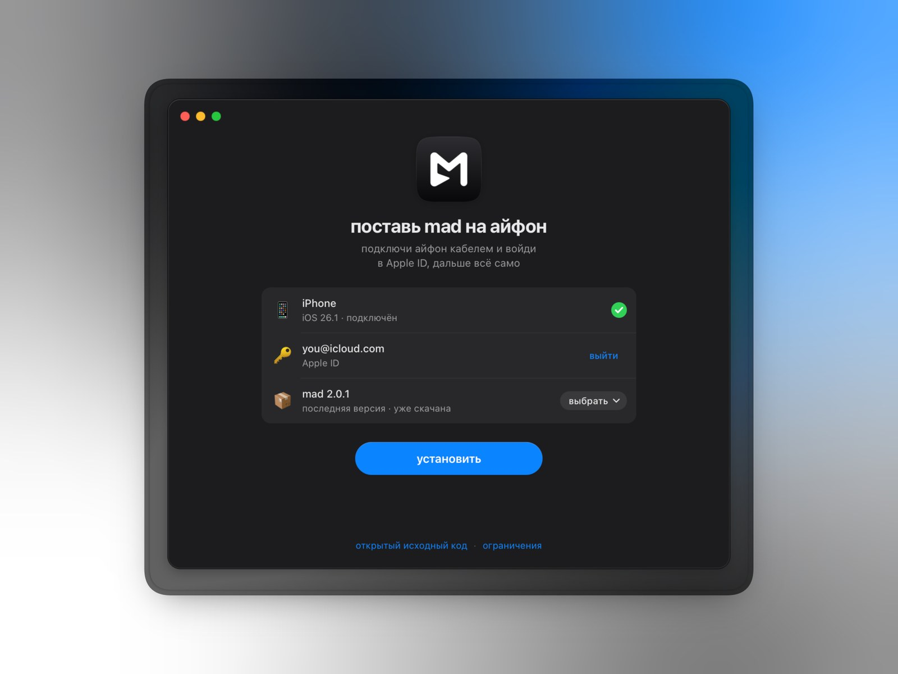
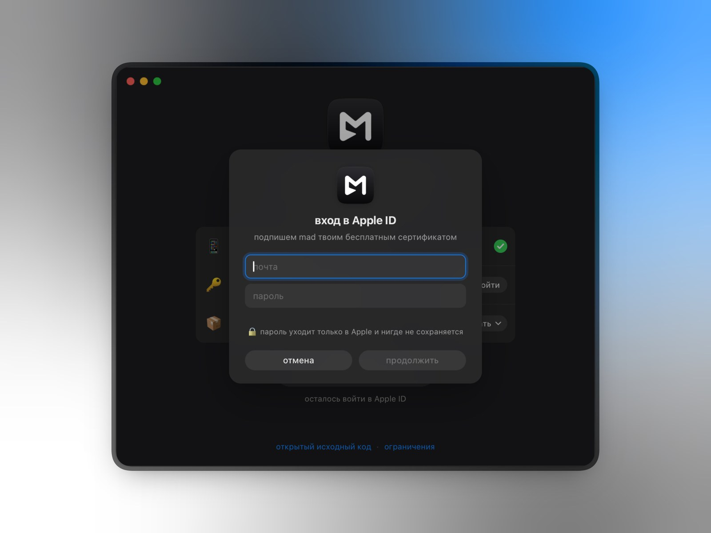
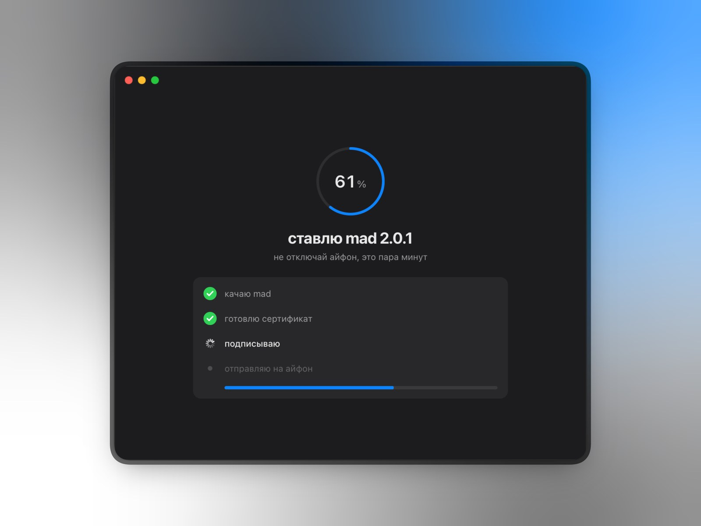
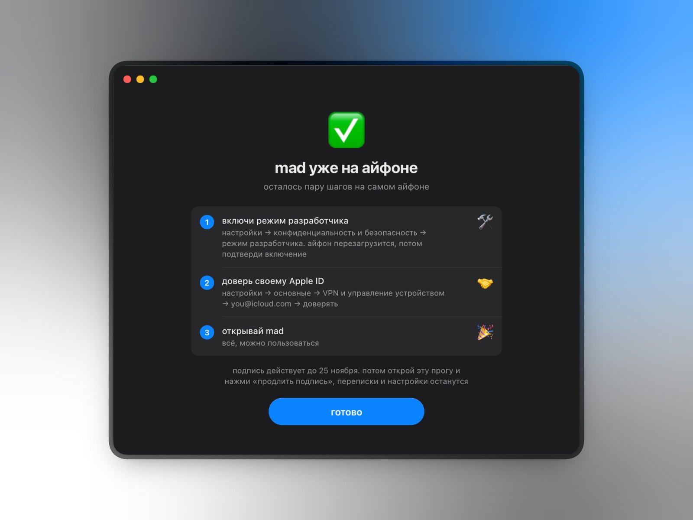

# mad installer

ставит [mad](https://github.com/yar2slav/Madgram-iOS) на айфон в пару кликов: подключи айфон кабелем, войди в свой Apple ID, нажми «установить». прога сама скачает выбранный релиз, подпишет его твоим бесплатным сертификатом и поставит на телефон. работает на macOS и Windows.

<p align="center">
  
  
  
  
</p>

## как пользоваться

1. скачай установщик из [релизов](../../releases/latest): `.dmg` для мака, `.exe` для винды
2. на винде поставь [Apple Devices](https://apps.microsoft.com/detail/9NP83LWLPZ9K) из Microsoft Store, без него винда не видит айфон
3. подключи айфон кабелем, разблокируй и нажми «доверять»
4. войди в Apple ID и нажми «установить». если mad уже стоит (например, через Sideloadly), войди тем же Apple ID: установщик обновит его поверх, переписки останутся
5. на айфоне: настройки → конфиденциальность и безопасность → режим разработчика, потом настройки → основные → VPN и управление устройством → твой Apple ID → доверять

установщик обновляется сам: когда выходит новая версия, справа вверху появляется кнопка «обновить».

## первый запуск

установщик не подписан сертификатом Apple или Microsoft, поэтому система в первый раз переспросит:

- **мак**: открой dmg и перетащи mad installer в «программы». при первом запуске нажми на него правой кнопкой → «открыть» → «открыть». если мак всё равно не пускает: системные настройки → конфиденциальность и безопасность → внизу «всё равно открыть»
- **винда**: если вылезет синее окно SmartScreen, нажми «подробнее» → «выполнить в любом случае»

## если айфон не находится

- **винда пишет «нужна программа Apple Devices»**: поставь её из Microsoft Store, открой один раз, подожди минуту и переподключи кабель
- **винда пишет «нужен драйвер Apple»**: открой центр обновления Windows → дополнительные параметры → необязательные обновления → обновления драйверов, поставь «Apple, Inc. USBDevice» и переподключи кабель
- **«айфон не отвечает»**: переподключи кабель напрямую в компьютер, без хабов, и закрой «Устройства Apple», пока ставишь mad

## ограничения бесплатного Apple ID

- подпись живёт 7 дней, потом нажми «продлить подпись»
- одновременно до 3 приложений с одного Apple ID
- до 10 App ID в неделю, mad занимает 2 (приложение и расширение «поделиться»)

## что с данными

- пароль уходит только в Apple (по протоколу SRP, в открытом виде не передаётся) и нигде не сохраняется
- после входа токен сессии и ключ сертификата лежат в системной связке ключей (Keychain на маке, Credential Manager на винде)
- служебные заголовки входа (anisette) берутся с публичного сервера `ani.iloader.app`, пароль и почта туда не попадают
- ipa качается прямо с GitHub-релизов `yar2slav/Madgram-iOS` и сверяется по sha256, который отдаёт GitHub
- обновления установщика подписаны отдельным ключом, приложение ставит только то, что подписано им

## сборка

нужны [Rust](https://rustup.rs) и [Bun](https://bun.sh).

```sh
bun install
bun run tauri dev
bun run tauri build
```

сборки для Windows и macOS собирает GitHub Actions (`.github/workflows/build.yml`) на каждый тег `v*` и прикрепляет их к релизу.

## спасибо

- [isideload](https://github.com/nab138/isideload) от nab138 (MIT): вход в Apple ID, сертификаты, подпись
- [idevice](https://github.com/jkcoxson/idevice) от jkcoxson (MIT): общение с айфоном
- [iloader](https://github.com/nab138/iloader) от nab138 (MIT)
- [apple-codesign-quick](https://github.com/Dadoum/apple-codesign-quick) и [Sideloader](https://github.com/Dadoum/Sideloader) от Dadoum
- эмодзи: Apple Color Emoji из [emoji-datasource-apple](https://github.com/iamcal/emoji-data)
- шрифт: SF Pro © Apple
- мокапы: [shots.so](https://shots.so)

mad installer не связан с Apple. лицензия MIT.
